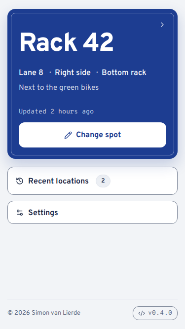

# Bikespot

[](https://github.com/simonvanlierde/bikespot/actions/workflows/ts.yml)
[](https://codecov.io/gh/simonvanlierde/bikespot)
[](https://bikespot.duinlab.nl)
[](LICENSE)
[](https://bikespot.duinlab.nl)

Bikespot helps you remember where you parked your bike. It's a web app you can install like an app (a PWA), and it works offline. Everything stays on your device: there's no account and no server.

It saves the spot the way a station bike park labels it (lane, side, rack level, distance, floor, rack number), or as a free-text description, with an optional photo, note and GPS coordinates.

It speaks English, Dutch, German, French, Danish, Swedish and Japanese. It follows your browser's language, and you can switch in Settings.

<!-- rumdl-disable MD033 -->
<p align="center">
<picture>
  <source media="(prefers-color-scheme: dark)" srcset="docs/screenshots/home-dark.png">
  
</picture>
</p>
<!-- rumdl-enable MD033 -->

## Install

Open **[bikespot.duinlab.nl](https://bikespot.duinlab.nl)** and add it to your home screen:

- **iOS (Safari):** Share → *Add to Home Screen*
- **Android (Chrome):** menu (⋮) → *Install app*
- **Desktop (Chrome/Edge):** install icon in the address bar

The app stores spots on this device, with no sync between devices. Export spots in Settings saves the current and recent spot details to a file, without photos or station settings. Import spots keeps the five newest spots in Recent and leaves your current spot unchanged. Restore a spot from Recent to make it current.

## Run it locally

```bash
pnpm install
pnpm dev
```

## Social card

`public/og.png` is the 1200x630 card shown when the link is shared. It is made with the generator in
[my site repo](https://github.com/simonvanlierde/simonvanlierde.github.io/tree/main/scripts/social-card)
(needs Docker). From a checkout of that repo, with this repo next to it:

```sh
pnpm gen:card --mark ../bikespot/public/icons/icon.svg --name "Bikespot" \
  --line "Save where you parked your bike and find it again later." \
  --domain bikespot.duinlab.nl --out ../bikespot/public/og.png
```

## Deploy

CI can deploy the checked build to Cloudflare Workers and create pull request previews.
[Deployment setup and the Pages migration](docs/architecture.md#deployment) cover the required environments, credentials and domain checks.

## More

- [CONTRIBUTING.md](CONTRIBUTING.md): prerequisites and checks
- [docs/architecture.md](docs/architecture.md): code layout, storage and deployment
- [docs/adr/](docs/adr/): design decisions
- [PRODUCT.md](PRODUCT.md) and [DESIGN.md](DESIGN.md): who it's for and how it looks

## License

[MIT](LICENSE) © Simon van Lierde
