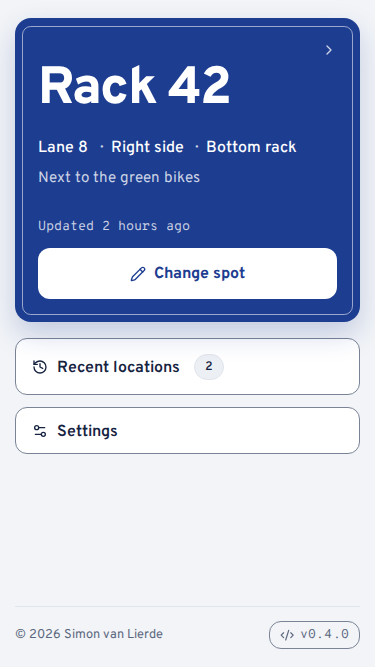

# Bikespot

[](https://github.com/simonvanlierde/bikespot/actions/workflows/ts.yml)
[](https://codecov.io/gh/simonvanlierde/bikespot)
[](https://bikespot.duinlab.nl)
[](https://scorecard.dev/viewer/?uri=github.com/simonvanlierde/bikespot)
[](LICENSE)
[](https://bikespot.duinlab.nl)

Bikespot helps you remember where you parked your bike. It's a web app you can install like an app (a PWA), and it works offline. Everything stays on your device: there's no account and no server.

It saves the spot the way a station bike park labels it (lane, side, rack level, distance, floor, rack number), or as a free-text description, with an optional photo, note and GPS coordinates.

It speaks English, Dutch, German, French, Danish, Swedish and Japanese. It follows your browser's language, and you can switch in Settings.

<!-- rumdl-disable MD033 -->
<p align="center">
<picture>
  <source media="(prefers-color-scheme: dark)" srcset="docs/screenshots/home-dark.png">
  
</picture>
</p>
<!-- rumdl-enable MD033 -->

## Install

Open **[bikespot.duinlab.nl](https://bikespot.duinlab.nl)** and add it to your home screen:

- **iOS (Safari):** Share → *Add to Home Screen*
- **Android (Chrome):** menu (⋮) → *Install app*
- **Desktop (Chrome/Edge):** install icon in the address bar

The app stores spots on this device, with no sync between devices. Export spots in Settings saves the current and recent spot details to a file, without photos or station settings. Import spots fills free Recent slots only (up to five), keeps what you already have, and leaves your current spot unchanged. Restore a spot from Recent to make it current.

## Development

You need Node.js 26 and [pnpm](https://pnpm.io/installation). [CONTRIBUTING.md](CONTRIBUTING.md) lists the rest.

```sh
pnpm install --frozen-lockfile
pnpm run check
pnpm run typecheck
pnpm run build
```

`pnpm dev` starts the dev server.

Tests live in `tests/`. The `*.test.ts(x)` files are Vitest unit and component tests (`pnpm test`), and
`tests/photos.browser.test.ts` runs in headless Chromium. `tests/e2e/` holds the Playwright specs for
accessibility, CSP, reflow and persistence, which run against the production build (`pnpm test:e2e`).

## Social card

`public/og.png` is the 1200x630 card shown when the link is shared. It shows the current-spot sign,
captured from the app. The source is [docs/og-card.html](docs/og-card.html); the captures it uses are in
`docs/og-card/`.

```sh
pnpm og-card:capture   # capture the sign and map from the app, with demo data, at 3x
pnpm og-card           # render docs/og-card.html to public/og.png
```

`pnpm og-card --option map` draws the other layout (the spot map and the distance to the bike). The build
adds the PNG's hash to the `og:image` URL, so a changed card gets a new URL.

## Deploy

CI can deploy the checked build to Cloudflare Workers and create pull request previews.
[Deployment setup and the Pages migration](docs/architecture.md#deployment) cover the required environments, credentials and domain checks.

## More

- [CONTRIBUTING.md](CONTRIBUTING.md): prerequisites, checks and coding standards
- [Code of conduct](.github/CODE_OF_CONDUCT.md)
- [docs/architecture.md](docs/architecture.md): code layout, storage and deployment
- [docs/adr/](docs/adr/): design decisions
- [PRODUCT.md](PRODUCT.md) and [DESIGN.md](DESIGN.md): who it's for and how it looks

## License

[MIT](LICENSE) © Simon van Lierde
