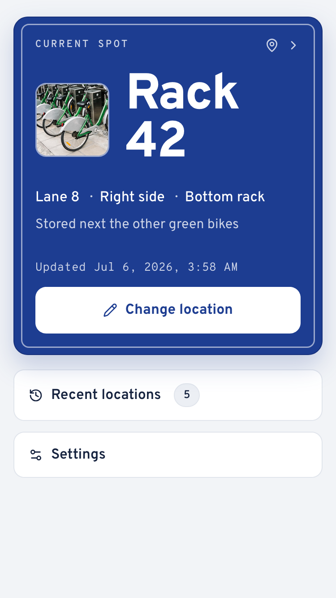

# Bikespot

[](https://github.com/simonvanlierde/bikespot/actions/workflows/ci.yml)
[](https://codecov.io/gh/simonvanlierde/bikespot)
[](https://bikespot.duinlab.nl)
[](LICENSE)
[](https://bikespot.duinlab.nl)

Bikespot helps you remember where you parked your bike. It's a web app you can install like an app (a PWA), and it works offline. Everything stays on your device: there's no account and no server.

It saves the spot the way a station bike park labels it (lane, side, rack level, distance, floor, rack number), or as a free-text description, with an optional photo, note and GPS coordinates.

<p align="center">
<picture>
  <source media="(prefers-color-scheme: dark)" srcset="docs/screenshots/home-dark.png">
  
</picture>
</p>

## Install

Open **[bikespot.duinlab.nl](https://bikespot.duinlab.nl)** and add it to your home screen:

- **iOS (Safari):** Share → *Add to Home Screen*
- **Android (Chrome):** menu (⋮) → *Install app*
- **Desktop (Chrome/Edge):** install icon in the address bar

The app works on one device only, on purpose: there's no sync between devices. To move spots to another device or keep a backup, use Export spots and Import spots in Settings. The export leaves photos out.

## Run it locally

```bash
pnpm install
pnpm dev
```

## More

- [CONTRIBUTING.md](CONTRIBUTING.md): prerequisites and checks
- [docs/architecture.md](docs/architecture.md): code layout, storage and deployment
- [docs/adr/](docs/adr/): design decisions
- [PRODUCT.md](PRODUCT.md) and [DESIGN.md](DESIGN.md): who it's for and how it looks

## License

[MIT](LICENSE) © Simon van Lierde
